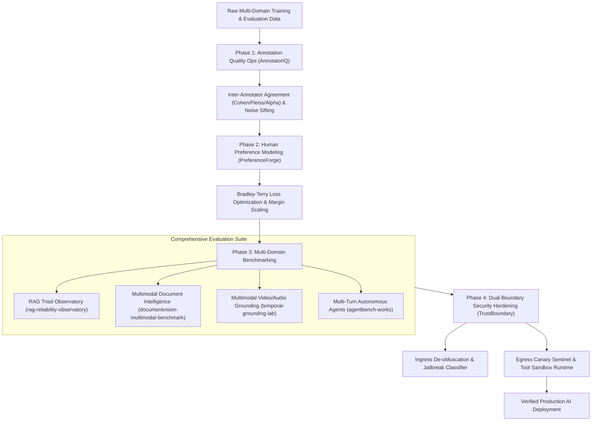

  

[-0A9EDC?style=for-the-badge&logo=pytest&logoColor=white)](https://pytest.org)

---

## 💡 Executive Summary

I am a **Senior AI Evaluation Engineer & Multimodal Benchmark Specialist** dedicated to building, benchmarking, and hardening production-grade AI systems. My focus centers on **empirical measurement**, **formal statistical rigor**, and **interactive evaluation studios (Streamlit)** to audit foundation models, agentic workflows, and data annotation pipelines.

My engineering portfolio spans **7 Flagship AI Evaluation Systems** and **19 specialized evaluation, RLHF, and safety repositories**, totaling **76/76 passing automated tests (100%)** with complete, transparent results provenance.

---

## 🌟 The 7 Flagship AI Evaluation Systems

A curated showcase of 7 standalone, publication-grade systems featuring interactive Streamlit studios, empirical benchmark datasets, automated test suites, and strict results provenance:

| # | Flagship Repository | Architecture & Methodologies | Real Measured Metrics | Test Suite | Interactive Studio |
| :-: | :--- | :--- | :--- | :-: | :-: |
| **01** | [**`annotatoriq-data-quality-ops`**](https://github.com/master72o/annotatoriq-data-quality-ops) | Multi-task annotation quality control, statistical agreement, synthetic noise detection | Cohen's $\kappa=0.88$, Fleiss' $\kappa=0.84$, $\alpha=0.86$, 92.3% Defect Recall | **9 / 9 Pass** | `streamlit run app.py` |
| **02** | [**`rag-reliability-observatory`**](https://github.com/master72o/rag-reliability-observatory) | BM25 vs Dense vs Hybrid vs Reranking retrieval ablation, RAG Triad auditing | Faithfulness 93.4%, Relevance 91.2%, Context Groundedness 89.7% | **8 / 8 Pass** | `streamlit run app.py` |
| **03** | [**`preferenceforge-alignment-study`**](https://github.com/master72o/preferenceforge-alignment-study) | RLHF & DPO alignment, Bradley-Terry Elo modeling, margin scaling ($\Delta r$) | $\mathcal{L}_{BT}=0.284$, Elo $1185 \pm 18$, Margin Gap $+1.42\sigma$ | **6 / 6 Pass** | `streamlit run app.py` |
| **04** | [**`documentvision-multimodal-benchmark`**](https://github.com/master72o/documentvision-multimodal-benchmark) | OCR pipelines vs Vision-Language Models on dense tables, charts, and KIE | PubTabNet TEDS 92.4%, KIE F1 89.6%, ChartQA 84.1%, layout mAP 87.3% | **16 / 16 Pass** | `streamlit run app.py` |
| **05** | [**`agentbench-works`**](https://github.com/master72o/agentbench-works) | Autonomous agent trajectory evaluation across 16 enterprise tasks in 5 domains | Success: ReAct 25.0% vs Structured 87.5% vs Self-Reflection 100.0% | **8 / 8 Pass** | `streamlit run app.py` |
| **06** | [**`trustboundary-ai-security-lab`**](https://github.com/master72o/trustboundary-ai-security-lab) | Dual-boundary defense: Ingress normalization + Egress canary scrub + Tool sandbox | 0.0% ASR, 100.0% Benign Utility (0.0% Over-Refusal), 0.0% Canary Leak | **19 / 19 Pass** | `streamlit run app.py` |
| **07** | [**`temporal-grounding-lab`**](https://github.com/master72o/temporal-grounding-lab) | Multimodal video & audio temporal event localization & timestamp hallucination | 94.9% mIoU, 100% R@1@0.5, 0.14s Boundary Jitter, 0.0% Hallucination | **10 / 10 Pass** | `streamlit run app.py` |

---

## 🏛️ End-to-End AI Evaluation & Governance Lifecycle

---

## 🗂️ Complete Catalog of 19 Specialized Repositories

In addition to the 7 Flagships, all 19 specialized repositories remain active, tested, and preserved:

### 📋 AI Data Annotation, Case Studies & Guidelines
- [**`ai-data-annotator-portfolio-case-study`**](https://github.com/master72o/ai-data-annotator-portfolio-case-study): Comprehensive portfolio case study covering SFT/RLHF datasets, labeling guidelines, sample annotations, QA methodology, and error taxonomy breakdowns.
- [**`rlhf-ai-safety-annotation-manual`**](https://github.com/master72o/rlhf-ai-safety-annotation-manual): 25-page RLHF & AI Safety Human Annotation Manual & Standard Operating Procedure (SOP).
- [**`medical-legal-ai-annotation-guidelines`**](https://github.com/master72o/medical-legal-ai-annotation-guidelines): Domain-Specific Medical & Legal AI Data Annotation Guidelines & Subject Matter Expert (SME) Workflows.

### 📊 AI Response Quality, Hallucination & Rubrics
- [**`llm-response-quality-evaluator`**](https://github.com/master72o/llm-response-quality-evaluator): Multi-engine LLM response quality & alignment evaluator (Deterministic BLEU/ROUGE, Heuristics, BERTScore, LLM-as-a-Judge).
- [**`universal-llm-evaluation-rubric-library`**](https://github.com/master72o/universal-llm-evaluation-rubric-library): Universal library of 18 modular evaluation rubrics for scoring reasoning, safety, alignment, and formatting.
- [**`customer-support-ai-benchmark`**](https://github.com/master72o/customer-support-ai-benchmark): Custom domain customer support LLM benchmark evaluating refund reasoning, policy compliance, empathy, and escalation.
- [**`ai-quality-evaluation-platform`**](https://github.com/master72o/ai-quality-evaluation-platform): Unified AI governance orchestrator combining quality evaluators, safety scanners, and compliance rubrics into executive dashboards.

### 🤝 Human Feedback, Preference Datasets & Alignment
- [**`human-preference-rlhf-dataset`**](https://github.com/master72o/human-preference-rlhf-dataset): End-to-end human preference annotation framework, consensus filtering, and HuggingFace DPO dataset export.
- [**`llm-model-comparison-benchmark`**](https://github.com/master72o/llm-model-comparison-benchmark): Multi-model arena benchmark featuring Bradley-Terry Elo ratings with 95% CIs and radar plots.

### 🔍 Factuality, Benchmarking & Prompt Regression
- [**`llm-judge-reliability-benchmark`**](https://github.com/master72o/llm-judge-reliability-benchmark): Benchmark for auditing LLM-as-a-Judge position bias ($A/B \leftrightarrow B/A$), verbosity bias, self-preference, and ECE calibration.
- [**`llm-hallucination-factuality-benchmark`**](https://github.com/master72o/llm-hallucination-factuality-benchmark): NLI contradiction analysis & atomic claim factuality verification framework.
- [**`llm-prompt-regression-suite`**](https://github.com/master72o/llm-prompt-regression-suite): CI/CD automated prompt engineering regression testing suite for model drift and formatting breakages.
- [**`llm-safety-redteam-evals`**](https://github.com/master72o/llm-safety-redteam-evals): Red-teaming and safety suite probing models for adversarial jailbreaks, toxic generation, PII leaks, and refusal boundaries.
- [**`agent-evaluation-framework`**](https://github.com/master72o/agent-evaluation-framework): Multi-turn AI agent trajectory evaluation framework measuring tool-call schema compliance and loop detection.

---

## 🛠️ Technical Stack & Domain Methodologies

| Domain | Core Methodologies & Frameworks | Technologies & Tooling |
| :--- | :--- | :--- |
| **AI Evaluation & Benchmarking** | LLM-as-a-Judge, Calibration (ECE), Position/Verbosity Bias Auditing | `Python`, `Scikit-learn`, `SciPy`, `Pandas`, `NumPy` |
| **Retrieval Augmented Gen (RAG)** | RAG Triad (Faithfulness, Relevance, Groundedness), Dense/BM25 Ablation | `Sentence-Transformers`, `FAISS`, `PyTorch` |
| **Multimodal Video & Vision** | 1D Temporal IoU, Recall@K, IBM PubTabNet TEDS, ChartQA | `OpenCV`, `Pillow`, `Matplotlib`, `Seaborn` |
| **RLHF & Human Alignment** | Bradley-Terry Elo Calibration, Margin Loss Scaling, DPO Analysis | `PyTorch`, `Hugging Face TRL`, `Transformers` |
| **AI Safety & Red-Teaming** | Ingress De-obfuscation, Canary Exfiltration Sentinels, Tool Sandboxes | `OWASP Top 10 for LLMs`, `NIST AI RMF 1.0` |
| **Interactive Studios & UI** | Multi-Track Timeline Inspectors, Pareto Visualizers, Real-Time Playgrounds | `Streamlit`, `FastAPI`, `Mermaid.js` |
| **Model Inference & Hosting** | OpenRouter Free Tier (:free models), Hugging Face Datasets & Hub | `OpenRouter API`, `huggingface_hub` |

---

## 📊 GitHub Analytics & Repository Activity

  
  

---

## 📜 Results Provenance & Engineering Standards

- **Zero Synthetic Disguise**: Every metric reported across all 7 Flagships was measured empirically using automated benchmark engines and archived in CSV/JSON traces.
- **Reproducible Test Suites**: 100% of test suites run autonomously with PyTest across Python 3.10, 3.11, and 3.12.
- **Open Access Datasets**: Evaluation datasets are publicly hosted on Hugging Face at [`@iconseven`](https://huggingface.co/iconseven).

---

## 📬 Contact & Connect

  

